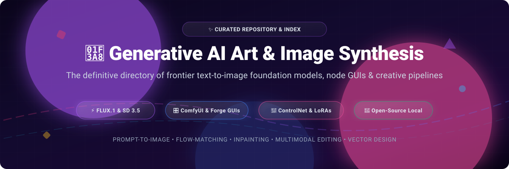

# Awesome Generative AI Art & Image Synthesis 

  

  
  
  
  

---

# 🎨 Top Generative AI Art & Image Synthesis 🚀

> **A definitive, highly curated catalog of frontier open-weight foundation models, local node-based web GUIs, diffusion workflows, vector design engines, and leading commercial SaaS platforms.**

*Covering Flow-Matching Architectures, Diffusion Transformers (DiT), FLUX.1, Stable Diffusion 3.5, Sana, ComfyUI, Forge, Fooocus, ControlNet, IP-Adapter, and LoRA Fine-Tuning pipelines.*

📅 **Last updated: November 2026** • 🌟 **Maintained by the AI Creative Community**

---

## 🔍 Overview & SEO Highlights

Welcome to the definitive directory for **Generative AI Art and Image Synthesis**. Whether you are looking for local GPU-accelerated open-source diffusion models (`ComfyUI`, `Stable Diffusion WebUI Forge`, `InvokeAI`) or high-throughput commercial APIs and SaaS platforms (`Midjourney`, `Adobe Firefly`, `OpenAI DALL·E 3`, `FLUX.1 Pro`), this repository indexes the most impactful tools across the modern visual generative AI stack.

### Key Technology Stacks Covered:
- ⚡ **Open-Weight Foundation Models**: Rectified Flow, DiT, Latent Diffusion (`FLUX.1-dev / schnell`, `Stable Diffusion 3.5`, `NVIDIA Sana`, `PixArt-Sigma`).
- 🎛️ **Node Studios & WebUIs**: Modular workflow canvases, prompt chaining, batch renderers (`ComfyUI`, `WebUI Forge`, `AUTOMATIC1111`, `Fooocus`, `SwarmUI`).
- 🎯 **Conditioning & Spatial Control**: Geometry guidance, pose transfer, face preservation (`ControlNet`, `IP-Adapter`, `T2I-Adapter`).
- 🧬 **Model Training & Fine-Tuning**: Low-Rank Adaptation (LoRA), Dreambooth, Textual Inversion (`Kohya_ss`, `ai-toolkit`, `Diffusers`).

---

## 📑 Table of Contents

- [📊 Sector Overview & Market Dynamics](#-sector-overview--market-dynamics)
- [☁️ SaaS/Hosted & Commercial Platforms](#️-saashosted--commercial-platforms)
- [💻 Open-Source GitHub Projects](#-open-source-github-projects)
- [🛠️ How to Contribute](#️-how-to-contribute)
- [📈 Star History](#-star-history)
- [💖 Support & Thank You](#-support--thank-you)
- [⚠️ Disclaimer](#️-disclaimer)

---

## 📊 Sector Overview & Market Dynamics

The global Generative AI Image Synthesis, Creative Design & Visual Content market is valued at approximately **$8.4B–$11.5B in 2026**, growing at a ~31% CAGR fueled by diffusion transformers (DiTs), flow-matching architectures, and real-time interactive generation. The consumer and enterprise creative market is **moderately fragmented**: frontier foundation models and mass distribution exhibit strong consolidation around tech giants and well-capitalized leaders (Adobe, OpenAI, Canva, Midjourney), while rapid open-source innovation, specialized vector engines, and fine-tuning studios sustain a vibrant, diverse ecosystem of competitive independent platforms.

---

## ☁️ SaaS/Hosted & Commercial Platforms

*Sorted descending by company valuation / annual revenue scale.*

| 🏢 Platform | 📝 Description | 💼 Company Scale (Valuation / Revenue) | 💳 Starting Paid Tier | 🎁 Free Tier / Trial Limit |
| :--- | :--- | :--- | :--- | :--- |
| **[Adobe Firefly](https://adobe.com)** | Commercially safe generative AI image, vector, and Generative Fill studio trained on licensed Adobe Stock and public-domain content. | **Part of Adobe Inc.** (~$21.5B+ annual revenue; ~$220B+ market cap) | **$4.99 / month** for Firefly Standard (100 generative credits/mo; also bundled in Creative Cloud) | **Forever Free Plan** (**25 monthly generative credits** with standard speed and watermarked downloads on free Adobe accounts) |
| **[OpenAI (DALL·E 3 / GPT Image)](https://openai.com)** | Native multimodal image synthesis and conversational editing integrated into ChatGPT and the OpenAI Images API. | **~$157B+ Valuation** (~$4B+ ARR run-rate) | **$20 / month** (ChatGPT Plus) or **$0.040 / image** (standard 1024×1024 via DALL·E 3 API) | **Forever Free ChatGPT Plan** (**2 to 3 image generations per day** on a rolling 24-hour reset window; standard resolution) |
| **[Leonardo.ai (Canva)](https://leonardo.ai)** | Production AI art, real-time canvas, Flow State, and custom model fine-tuning platform built for game artists, illustrators, and marketers. | **Acquired by Canva for ~$370M+** (Part of $26B+ Canva valuation; ~$2.5B+ Canva ARR) | **$10 / month** billed annually ($12/mo monthly for Apprentice plan; 8,500 fast tokens/mo) | **Forever Free Plan** (**150 fast tokens daily** resetting every 24 hours; public image visibility and standard queue) |
| **[Black Forest Labs (FLUX.1 / FLUX Pro API)](https://blackforestlabs.ai)** | Frontier Rectified Flow image generation models (`FLUX.1 [pro]`, `FLUX.1.1 [pro] Ultra`, `FLUX Kontext`) hosted via BFL API and partner clouds. | **~$1.0B+ Valuation** ($31M+ seed/Series A; founded by core Stable Diffusion architects) | **$0.03 – $0.06 / image** pay-as-you-go via BFL API (1 credit = $0.01; no monthly base fee) | **No Free Hosted Trial/Credits** (**0 free API credits** on official BFL API/Playground; free usage is via Apache 2.0 open-weight `FLUX.1 [schnell]` self-hosting) |
| **[Stability AI (Stable Diffusion Cloud / DreamStudio)](https://stability.ai)** | Hosted cloud API and DreamStudio web interface for Stable Diffusion 3.5 Large, SDXL, ControlNet, and image-to-video pipelines. | **~$1.0B Peak Valuation** ($80M+ recapitalization; enterprise & developer API focus) | **$0.03 – $0.065 / image** (3–6.5 credits per SD 3.5 image; $10 buys 1,000 credits) or **$20/mo** Core Membership | **One-Time Free Trial** (**25 free credits** on Developer Platform API registration; one-time 500 trial credits on legacy DreamStudio accounts, non-refilling) |
| **[Ideogram](https://ideogram.ai)** | Generative AI image platform celebrated for industry-leading typography rendering, graphic design posters, Magic Prompt, and Canvas editing. | **~$300M–$500M+ Valuation** ($80M+ Series A led by Andreessen Horowitz) | **$7 / month** billed annually ($8/mo monthly for Basic plan; 400 priority credits/mo) | **Forever Free Plan** (**30 credits per week** with standard queue, 1 concurrent generation, and public gallery visibility) |
| **[Midjourney](https://midjourney.com)** | Flagship artistic AI image synthesis platform renowned for aesthetic coherence, style references (`--sref`), character consistency, and web editor. | **~$300M+ Annual Revenue** (Bootstrapped, profitable independent AI research lab) | **$10 / month** ($8/mo billed annually for Basic plan; ~200 fast GPU minutes/mo) | **No Free Trial / Plan** (Standard web and Discord generation requires minimum $10/mo subscription; occasional limited promo events only) |
| **[Recraft](https://recraft.ai)** | Infinite-canvas AI graphic design studio capable of generating true editable SVG vector illustrations, brand-consistent icon sets, and mockups. | **~$150M–$300M Est. Valuation** ($12M+ Series A; #1 Hugging Face Text-to-Image Arena leader) | **$10 / month** billed annually ($12/mo monthly for Basic plan; 1,000 credits/mo) | **Forever Free Plan** (**3 style generations and 3 image uploads daily**; non-commercial personal use with public gallery visibility) |
| **[NightCafe](https://nightcafe.studio)** | Multi-model AI art generator and social creator community offering access to FLUX, SDXL, DALL·E 3, Ideogram, and daily art challenges. | **~$10M–$25M Est. Scale** (Bootstrapped Australian AI art platform; >25M users) | **$4.79 / month** billed annually ($5.99/mo monthly for AI Beginner plan; 100 credits/mo) | **Forever Free Daily Rewards** (First creation of the day is free up to 8 credits + **5 to 7 free credits daily** claimed via active login streak; standard queue) |
| **[Artbreeder](https://artbreeder.com)** | Collaborative genetic-breeding, portrait Mixer, Collager, and Poser AI art studio allowing creators to blend genes and control compositions. | **~$10M–$20M Est. Scale** (Pioneering indie creative AI platform; >10M users) | **$7.49 / month** billed annually ($8.99/mo monthly for Starter plan; 100 credits/mo) | **Forever Free Plan** (**10 free credits per month**; unlimited public Splicer/Collager gene editing and 512px standard resolution downloads) |

---

## 💻 Open-Source GitHub Projects

*Sorted descending by GitHub stargazer count. Badges link directly to each repository's stargazers page.*

| 📦 Repository & Stars | 📜 License & Cost | ⚙️ Focus Area | 📝 Description |
| :--- | :--- | :--- | :--- |
| **[AUTOMATIC1111/stable-diffusion-webui](https://github.com/AUTOMATIC1111/stable-diffusion-webui)**    | **AGPL-3.0**   (100% Free / Self-hosted) | Local WebUI Studio | The original standard browser GUI for Stable Diffusion, featuring extensive extension ecosystems, textual inversions, inpainting, and prompt tooling. |
| **[comfyanonymous/ComfyUI](https://github.com/comfyanonymous/ComfyUI)**    | **GPL-3.0**   (100% Free / Self-hosted) | Node-Based Modular Pipeline | The most powerful and modular visual graph/node-based GUI and backend for FLUX, SD3.5, SDXL, and custom diffusion pipeline execution. |
| **[CompVis/stable-diffusion](https://github.com/CompVis/stable-diffusion)**    | **CreativeML OpenRAIL-M**   (100% Free / Self-hosted) | Foundation Latent Diffusion | Seminal high-resolution image synthesis with latent diffusion models, foundational to the entire modern open-source text-to-image ecosystem. |
| **[lllyasviel/Fooocus](https://github.com/lllyasviel/Fooocus)**    | **GPL-3.0**   (100% Free / Self-hosted) | Midjourney-like Offline GUI | Image generation software that re-thinks SDXL design, automating prompt expansions and style presets for Midjourney-quality output with zero manual tuning. |
| **[huggingface/diffusers](https://github.com/huggingface/diffusers)**    | **Apache-2.0**   (100% Free / Self-hosted) | Python Inference & Training Library | The industry-standard PyTorch library for state-of-the-art pretrained diffusion models across image, video, and audio synthesis pipelines. |
| **[lllyasviel/ControlNet](https://github.com/lllyasviel/ControlNet)**    | **Apache-2.0**   (100% Free / Self-hosted) | Spatial Conditioning Neural Network | Groundbreaking architecture adding spatial conditioning controls (Canny edges, OpenPose human poses, Depth maps, normals) to diffusion models. |
| **[invoke-ai/InvokeAI](https://github.com/invoke-ai/InvokeAI)**    | **Apache-2.0**   (100% Free / Self-hosted) | Professional Creative Canvas | Leading creative engine and infinite canvas studio tailored for game developers, digital illustrators, and design studios using local diffusion. |
| **[black-forest-labs/flux](https://github.com/black-forest-labs/flux)**    | **Apache-2.0 / Non-Commercial**   (100% Free / Self-hosted) | Frontier Flow-Matching Models | Official repository for 12B parameter Rectified Flow transformer foundation models (`FLUX.1 [dev]` and Apache-2.0 `FLUX.1 [schnell]`). |
| **[lllyasviel/stable-diffusion-webui-forge](https://github.com/lllyasviel/stable-diffusion-webui-forge)**    | **AGPL-3.0**   (100% Free / Self-hosted) | High-Performance WebUI | Lightweight, heavily optimized fork of WebUI with dedicated memory management for low-VRAM GPUs running FLUX, SD 3.5, and SDXL effortlessly. |
| **[ostris/ai-toolkit](https://github.com/ostris/ai-toolkit)**    | **Apache-2.0**   (100% Free / Self-hosted) | LoRA & Model Training Suite | Comprehensive, high-speed training toolkit and LoRA fine-tuning suite specifically engineered for FLUX.1 and diffusion transformers. |
| **[bmaltais/kohya_ss](https://github.com/bmaltais/kohya_ss)**    | **Apache-2.0**   (100% Free / Self-hosted) | Fine-Tuning & Training GUI | Graphical user interface for Kohya's SD/SDXL/FLUX training scripts, enabling Dreambooth and LoRA character and style fine-tuning. |
| **[NVlabs/Sana](https://github.com/NVlabs/Sana)**    | **NVIDIA Open Model**   (100% Free / Self-hosted) | Ultra-Fast Linear DiT Model | NVIDIA's high-efficiency text-to-image framework synthesizing up to 4K resolution images with remarkable speed and low compute requirements. |
| **[tencent-ailab/IP-Adapter](https://github.com/tencent-ailab/IP-Adapter)**    | **Apache-2.0**   (100% Free / Self-hosted) | Image Prompt Adapter | Lightweight image prompt adapter for pretrained text-to-image diffusion models, enabling image-guided generation and consistent visual styling. |

---

## 🛠️ How to Contribute

Contributions are wholeheartedly welcome! To add or update an entry:
1. 🍴 **Fork this repository**.
2. 🌿 Create a branch for your addition (`git checkout -b feature/add-new-tool`).
3. ✍️ Add factual information linking to official documentation or codebases.
4. 🚀 Submit a **Pull Request** with clear descriptions.

---

## 📈 Star History

---

## 💖 Support & Thank You

Thank you so much for exploring and supporting **Awesome Generative AI Art & Image Synthesis**! 🎉

If you find this curated directory helpful for your research, projects, or creative workflows:
- ⭐ **Star this repository** to show your appreciation and help fellow creators discover it.
- 🍴 **Fork and share** with colleagues, digital artists, and ML developers.
- ☕ **Buy me a coffee / sponsor the project** to support continued maintenance and curation:  
  👉 **[Sponsor on GitHub Sponsor Dashboard](https://github.com/sponsors/ishandutta2007)**

---

## ⚠️ Disclaimer

*This list is curated for informational, educational, and developer reference purposes. Trademarks and brand names belong to their respective corporate entities or open-source authors. Always verify licenses for commercial compliance before deploying models or hosted APIs in production.*
